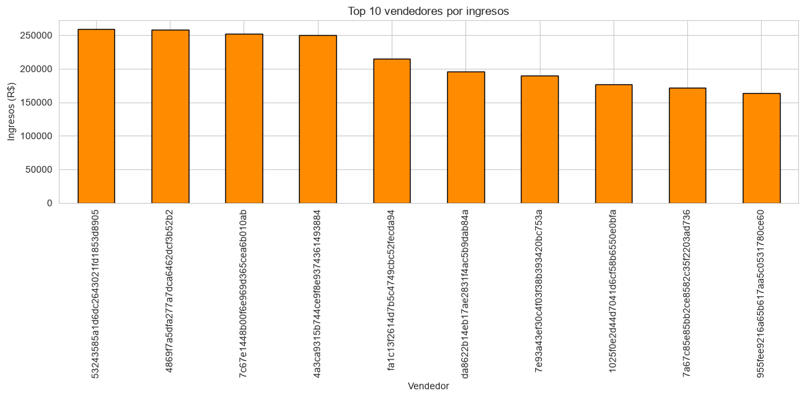
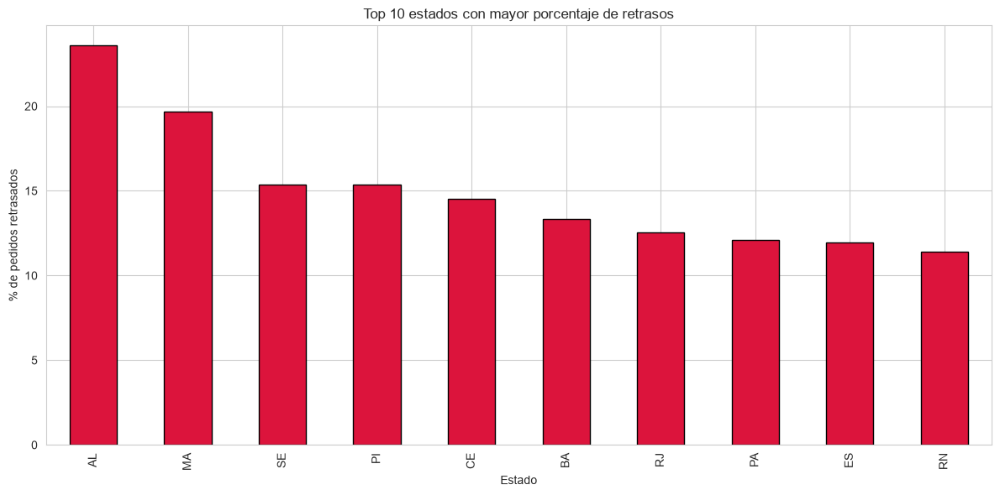
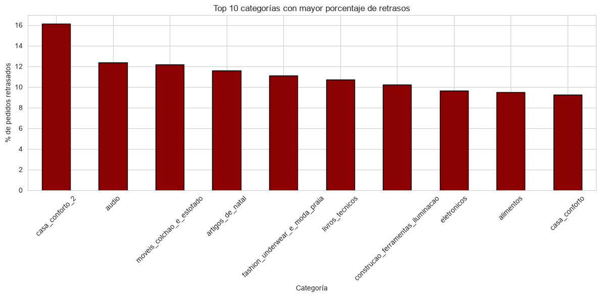

# analisis-ventas-ecommerce

Descripción

Proyecto de análisis de datos desarrollado a partir de múltiples tablas relacionales de una plataforma de comercio electrónico. El objetivo es comprender el comportamiento comercial y logístico del negocio mediante la integración de información de clientes, pedidos, productos, pagos y vendedores.

Objetivos

Analizar la facturación del negocio.
Identificar las categorías de productos más rentables.
Evaluar la distribución geográfica de los ingresos.
Analizar el desempeño de los vendedores.
Evaluar la eficiencia logística y los retrasos en las entregas.
Detectar oportunidades de mejora para el negocio.

Dataset

El proyecto utiliza múltiples tablas relacionadas:

Clientes
Pedidos
Productos
Pagos
Vendedores
Categorías de productos

Tecnologías utilizadas

Python
Pandas
NumPy
Matplotlib
Seaborn
Jupyter Notebook

Proceso realizado

Carga e integración de múltiples tablas.
Validación de relaciones entre entidades.
Análisis de calidad de datos.
Construcción de una tabla maestra para análisis.
Análisis comercial.
Análisis logístico.
Identificación de hallazgos estratégicos.

Principales hallazgos

📈 Facturación total: R$ 16,57 millones.

🏷️ Las categorías Belleza y Salud, Relojes y Regalos y Hogar generan los mayores ingresos.

📍 São Paulo es el principal mercado de la plataforma.

🚚 Tiempo promedio de entrega: 12 días.

✅ El 92,16% de los pedidos se entregaron dentro del plazo prometido.

⚠️ Alagoas y Maranhão presentan los mayores porcentajes de retrasos.

📦 No se observó una relación directa entre las categorías más rentables y aquellas con mayores retrasos logísticos

Visualizaciones

Categorías con mayor generación de ingresos

Estados con mayores ingresos

Top vendedores por ingresos

Estados con mayor porcentaje de retrasos

Categorías con mayores retrasos

Conclusiones

Los resultados muestran que la plataforma mantiene un sólido desempeño comercial y una buena eficiencia logística general. Sin embargo, se identificaron oportunidades de mejora relacionadas con determinadas categorías y regiones que presentan mayores niveles de retraso en las entregas.

La integración de múltiples tablas permitió construir una visión integral del negocio y generar información útil para la toma de decisiones comerciales y operativas.

Autor
Román Vicente Lemos

Técnico Universitario en Ciencia de Datos